<div align="center">

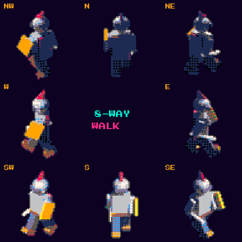

# 🧱 Pixel Sprite Forge

**Addon de Blender que convierte cualquier modelo 3D animado en sprite sheets de pixel art en 8 direcciones, listos para Godot, Unity, Phaser y PixiJS.**


</div>

---

## El problema

Animar pixel art cuadro a cuadro (caminar, atacar, saltar… × 8 direcciones) lleva semanas. Animar en 3D es mucho más rápido, pero convertir ese 3D en pixel art **auténtico** (paleta limitada, dithering real, contornos limpios y hojas de sprites bien recortadas) suele requerir trucos de compositor o herramientas externas.

**Pixel Sprite Forge lo hace con un botón**, dentro de Blender.

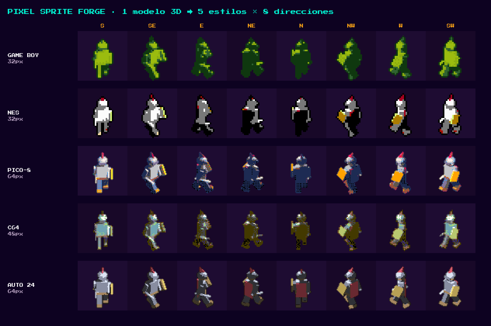

## ✨ Qué hace

| | Característica | Detalle |
| :-: | :-- | :-- |
| 🎯 | **Resolución virtual** | 16, 24, 32, 48, 64, 96, 128, 256 px o personalizada. Supermuestreo 1/2/4/8× para siluetas estables. |
| 🎨 | **Paletas históricas** | Game Boy, Game Boy Pocket, NES (2C02), PICO-8, Commodore 64, CGA, Sweetie 16, Endesga 32, **automática** (k-means en OKLab) o **archivo** `.hex` / `.pal` / `.gpl` (p. ej. de [Lospec](https://lospec.com/palette-list)). |
| ▦ | **Dithering** | Bayer 2×2, 4×4, 8×8 (mezcla entre los 2 colores más cercanos: no ensucia colores planos) y Floyd–Steinberg (sin fugas hacia el fondo transparente). |
| ✏️ | **Contorno inteligente** | Exterior o interior, 4 u 8 vecinos, color fijo o **adaptativo** (color vecino oscurecido y ajustado a la paleta, estilo *selout*). |
| 🌗 | **Cel shading** | Agrupa la luz en N bandas antes de cuantizar, más saturación / contraste / brillo. |
| 🧭 | **Rig de cámara 8 direcciones** | Cámara ortográfica orbital en 1, 2 (plataformas), 4 u 8 direcciones (S, SE, E, NE, N, NW, W, SW), vista lateral, 3/4, isométrica, cenital o personalizada. **Encuadre automático** fijo para todos los frames y direcciones: el sprite no "tiembla". |
| ↔️ | **Espejo de direcciones** | W, NW y SW se generan volteando E, NE y SE: **~40 % menos renders** (normales con X invertida). |
| 🏃 | **Root motion** | *Seguir al personaje*: la cámara acompaña al objeto (o a un hueso raíz) y el sprite queda centrado aunque la animación avance. |
| 📍 | **Pivote real** | El JSON guarda dónde caen los pies del personaje en cada frame, para alinearlo al suelo en el motor. |
| 🎞️ | **GIF animados** | Un GIF por acción y dirección (escala ×1–×12, transparencia, loop), con un codificador propio sin dependencias. |
| 🎬 | **Varias acciones a la vez** | Detecta todas las acciones (walk, attack, jump…) y las hornea en una sola hoja, con cada N frames y FPS de salida. |
| 📦 | **Sprite sheet packer** | Cuadrícula (una fila por acción+dirección) o empaquetado con **recorte de transparencia**, separación y potencia de 2. |
| 🗂️ | **Metadatos** | JSON estilo TexturePacker (Phaser 3, PixiJS, Unity con importador) + `animations` + `frameTags` · **Godot 4 `SpriteFrames` (.tres)** listo para `AnimatedSprite2D`. |
| 💡 | **Normal maps** | Hoja de normales alineada píxel a píxel con el sprite (convención OpenGL, Y+), para luces 2D dinámicas. Para Godot genera además `CanvasTexture` y un `SpriteFrames` iluminado. |
| 👁️ | **Vista previa en vivo** | Renderiza el frame actual con el estilo final y lo muestra en el Editor de Imágenes; en modo *en vivo* se actualiza al cambiar de frame, dirección o ajustes. |
| ⚡ | **Estilos rápidos** | Game Boy · NES · PICO-8 · C64 · Indie moderno · HD pixel. |

<div align="center">
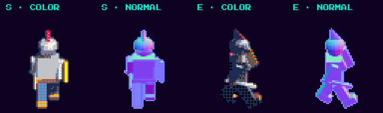
</div>

## 📥 Instalación

1. Descarga `pixel_sprite_forge-1.1.1.zip` (o genera el tuyo con `python3 build.py`).
2. Blender 4.2+ → **Editar › Preferencias › Add-ons** → menú ⌄ → **Instalar desde disco…** → elige el `.zip`.
3. En la Vista 3D pulsa **N** y abre la pestaña **Pixel Forge**.

> ¿Quieres probarlo ya? Abre `examples/demo_scene.py` en el Editor de Texto de Blender y pulsa *Run Script*: crea un caballero low-poly con ciclo de caminata.

## 🕹️ Uso en 5 pasos

1. **Personaje** — elige el objeto animado (armature, malla o un empty padre de varias piezas).
2. **Cámara** — direcciones (1 / 4 / 8), tipo de vista y hacia dónde mira tu personaje (por defecto `-Y`). Pulsa *Crear / actualizar rig* y usa la brújula para revisar cada dirección.
3. **Estilo** — resolución, paleta, dithering y contorno (o un estilo rápido).
4. **Animaciones** — *Acción actual* (rango de la escena) o *Lista de acciones* → 🔍 *Detectar acciones*.
5. **Exportar** — carpeta, nombre y **Generar sprite sheet**.

Salida (ejemplo `character`):

```
sprites/
├── character.png            # sprite sheet
├── character_n.png          # normal map (misma distribución)
├── character.json           # Phaser / PixiJS / Unity
├── character_frames.tres    # Godot 4 SpriteFrames
├── character_canvas.tres    # Godot CanvasTexture (color + normal)
└── character_frames_lit.tres# SpriteFrames que usa la CanvasTexture
```

Los nombres siguen el patrón **`<acción>_<dirección>_<frame>`** (`walk_SE_003`) y las animaciones **`<acción>_<dirección>`** (`walk_SE`).

<details>
<summary><b>Ejemplo de hoja generada (PICO-8, 64 px, 8 direcciones × 9 frames)</b></summary>
<br>
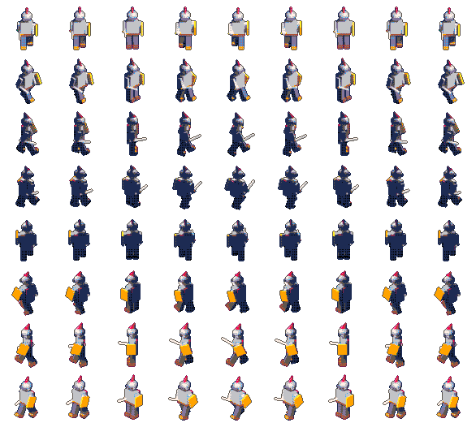
</details>

## 🧪 Casos de uso verificados

Cada caso construye una escena por código, hornea de principio a fin en Blender real y comprueba el resultado (`tests/test_use_cases.py`, **27 verificaciones**).

| Caso | Escena | Qué se verifica |
| :-- | :-- | :-- |
| **UC1 · Héroe RPG** | Armature con huesos, torso con *skinning*, 3 acciones (idle, walk, attack), 8 direcciones con espejo | 112 frames con solo 70 renders · las piernas y el brazo cambian la silueta · W = espejo exacto de E · nariz a la derecha en E · pivote de pies estable · 24 GIF · normal map alineado · se restaura la acción original |
| **UC2 · Plataformas** | Mismo héroe, 2 direcciones, vista lateral, paleta `.hex` estilo Lospec, Floyd–Steinberg | Solo `walk_E` y `walk_W` · solo los colores del archivo · cuadrícula correcta |
| **UC3 · Root motion** | Corredor que avanza 4 m | Con *seguir*: centrado (0 px de variación) y encuadre 9× más ajustado · sin *seguir*: se desplaza 13 px |
| **UC4 · Prop isométrico** | Casa estática con puerta y chimenea, paleta NES | 8 vistas · la puerta se ve desde S y queda oculta desde N |
| **UC5 · Vista previa** | Acción `attack` seleccionada en la lista | La vista previa usa la acción elegida |

| UC1 walk SE | UC1 attack E | UC1 idle S | UC2 plataformas | UC3 sin seguir | UC3 siguiendo |
| :-: | :-: | :-: | :-: | :-: | :-: |
| 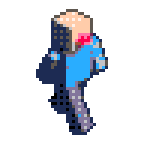 | 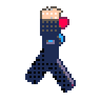 | 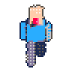 | 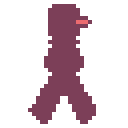 | 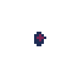 | 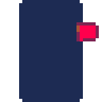 |

<details>
<summary><b>UC4 · las 8 vistas isométricas de la casa</b></summary>
<br>

</details>

## 🤓 Hecho con Pixel Sprite Forge: mi humano digital

Mi [humano digital](https://github.com/Jlpineda12/digital-human) se horneó con este addon: un busto modelado por script en Blender, con una animación idle, en **8 direcciones a 128×128**, con mi paleta de 17 colores (`.hex`), contorno adaptativo y *normal map*. El script está en [`digital-human/blender/bake_pixel.py`](https://github.com/Jlpineda12/digital-human/blob/main/blender/bake_pixel.py) y muestra cómo usar el addon sin interfaz (`bpy.ops.pixel_forge.bake()`).

<div align="center">
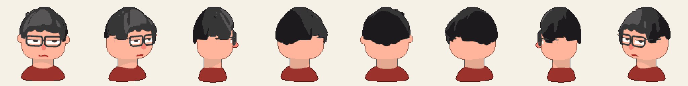
</div>

## 🎮 En tu motor

**Godot 4** — arrastra `character_frames.tres` al `sprite_frames` de un `AnimatedSprite2D`. El script [`examples/godot/eight_way_character.gd`](examples/godot/eight_way_character.gd) elige la animación según la dirección de movimiento (8 o 4 direcciones). Para luces 2D (`PointLight2D`) usa `character_frames_lit.tres`.

**Phaser 3** — `this.load.atlas('hero', 'character.png', 'character.json')` y crea las animaciones desde `json.animations`. Demo completa en [`examples/phaser/index.html`](examples/phaser/index.html).

**PixiJS** — `Assets.load('character.json')` → `sheet.animations['walk_SE']` con `AnimatedSprite`.

**Unity** — usa la distribución *Cuadrícula*: en el importador `Sprite Mode: Multiple` → *Slice › Grid By Cell Size* con el tamaño de celda (+ separación). El JSON sirve con importadores de TexturePacker.

## ⚙️ Cómo funciona

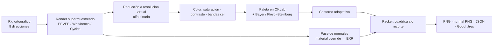

- El color se cuantiza en **OKLab** (espacio perceptual), así el "color más cercano" se ve correcto.
- Durante el horneado se usa la vista de color **Standard** (AgX/Filmic desaturan y arruinarían la paleta) y luego se restaura toda la configuración de la escena.
- Las normales se renderizan en espacio mundo y se convierten a espacio de cámara con la matriz de la cámara: el resultado es idéntico en cualquier motor de render.
- El PNG se escribe con un codificador propio de 8 bits: los colores de la paleta salen exactos, sin gestión de color de por medio.

## 🧪 Pruebas

```bash
python3 tests/test_pipeline.py                                    # 11 pruebas, solo numpy
blender -b --factory-startup --python tests/test_blender.py       # 25 pruebas en Blender real
blender -b --factory-startup --python tests/test_use_cases.py     # 27 verificaciones en 5 casos de uso
```

La prueba de Blender construye un personaje con una "nariz" roja hacia `-Y`, hornea 2 acciones × 8 direcciones y verifica: archivos generados, número de frames, que **solo** se usen colores de la paleta, que en `E` mire a la derecha, en `W` a la izquierda, en `S` a cámara y en `N` de espaldas, que el normal map esté alineado y apunte a la cámara, y que la escena quede como estaba.

## ⚠️ Limitaciones conocidas

- La vista previa se muestra en el **Editor de Imágenes** (no es un shader del viewport): así es exacta a la exportación. El compositor de Blender no puede mapear a una paleta exacta y su API cambió en 5.0, por eso el procesado se hace en numpy.
- Con *Espejar* el dithering Bayer no es simétrico píxel a píxel (la silueta sí); si la luz viene de un lado, desactívalo.
- Probado en **Blender 5.2.3 con Cycles, EEVEE y Workbench**. Con Workbench el color sale del *Viewport Display* de cada material, y el pase de normales se hace automáticamente con EEVEE (Workbench ignora los nodos). La importación en Godot/Unity no se probó dentro de los motores; la demo de Phaser sí.

## 🗂️ Estructura

```
pixel-sprite-forge/
├── pixel_sprite_forge/      # el addon
│   ├── __init__.py          # registro + bl_info
│   ├── blender_manifest.toml# manifiesto de extensión (Blender 4.2+)
│   ├── properties.py        # ajustes guardados en la escena
│   ├── rig.py               # cámara orbital, direcciones, encuadre automático
│   ├── baker.py             # render por acción × dirección × frame, normales, exportación
│   ├── imaging.py           # pipeline pixel art (numpy puro)
│   ├── palettes.py          # paletas + lectores .hex / .pal / .gpl + k-means
│   ├── packer.py            # empaquetado, PNG, JSON, Godot .tres
│   ├── gif.py               # codificador GIF animado (LZW) sin dependencias
│   ├── operators.py         # botones, presets, vista previa en vivo
│   └── ui.py                # panel "Pixel Forge"
├── examples/                # escena demo, script Godot, demo Phaser
├── tests/                   # pruebas numpy, Blender headless y casos de uso
├── docs/                    # imágenes de este README
└── build.py                 # genera dist/pixel_sprite_forge-x.y.z.zip
```

## 👤 Autor

**Jose Luis Pineda Barrera** · [@Jlpineda12](https://github.com/Jlpineda12) · Ingeniería en Multimedia, Colombia 🇨🇴 · Licencia GPL-3.0-or-later (requisito de los addons de Blender).
